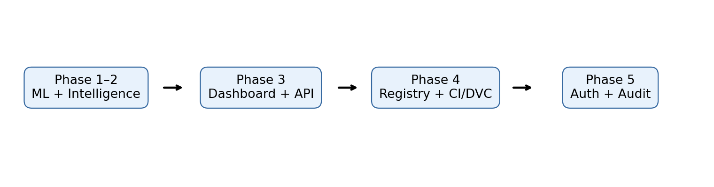
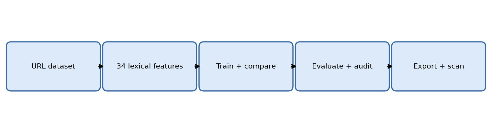
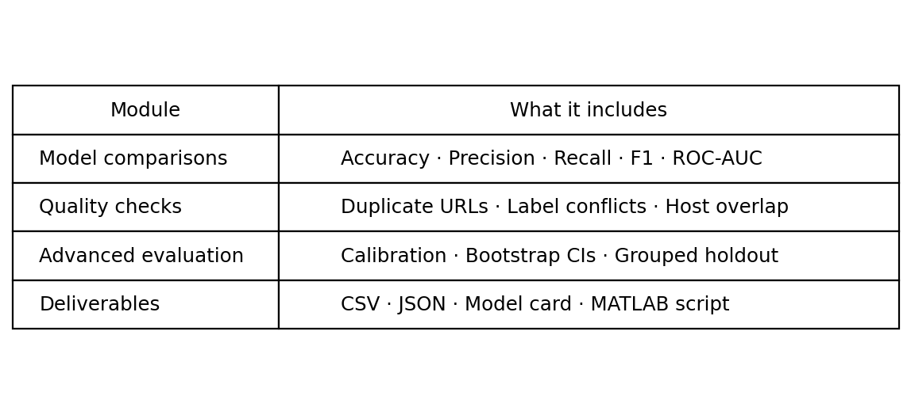
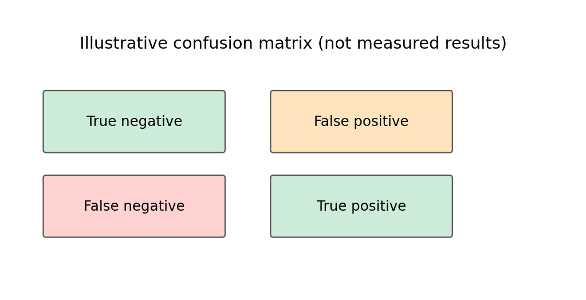
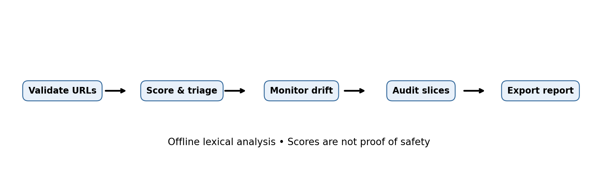
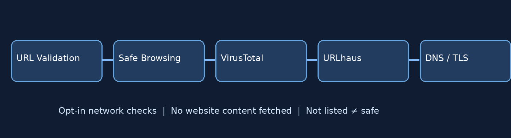
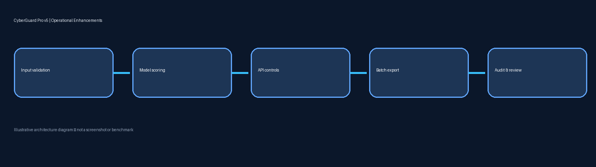

# CyberGuard Pro v5 — Phases 1–5 + Operational Enhancements



**Educational URL risk analysis platform.** Phases 1–2 remain in the original notebook and threat-intelligence module; phases 3–5 add a deployable **starter implementation**. No real-world accuracy or production security certification is claimed.

## Included features

| Phase | Implemented |
|---|---|
| 1 — Advanced ML | XGBoost, LightGBM, CatBoost, Optuna, MLflow and reproducibility notebook |
| 2 — Threat intelligence | Opt-in Google Safe Browsing, VirusTotal, URLhaus, DNS/TLS checks |
| 3 — Web dashboard | Streamlit interface, FastAPI `/scan`, CSV batch (500 max), Plotly charts, PDF and CSV export |
| 4 — MLOps | Docker, GitHub Actions CI, DVC dataset-audit stage, versioned local model registry, monitoring summary |
| 5 — Enterprise starter | Bearer-token authentication, SQLite audit events, version activation/rollback, local-only Docker port, unprivileged container |

## Installation

```bash
python -m venv .venv
# Linux/macOS: source .venv/bin/activate
# Windows PowerShell: .venv\Scripts\Activate.ps1
pip install -r requirements-app.txt
```

Create a strong random token and set `CYBERGUARD_API_TOKEN` as an environment variable. **Do not commit `.env` or secrets.**

### 1. Register a trusted model

Train the existing notebook with a real `urls.csv` containing `url,label` (0 benign, 1 malicious). It writes `phase1_artifacts/cyberguard_phase1_best.joblib` after execution. From the project root:

```bash
python manage_models.py register phase1_artifacts/cyberguard_phase1_best.joblib v1
python manage_models.py activate v1
python manage_models.py status
```

To roll back, register another trusted model under a different version and activate the earlier one, e.g. `python manage_models.py activate v1`. **Never load untrusted joblib/pickle models.** Model artifacts are intentionally not shipped in this ZIP.

### 2. Run dashboard and API

```bash
streamlit run app/dashboard.py
uvicorn app.api:app --host 127.0.0.1 --port 8000
```

API request (replace YOUR_TOKEN):

```bash
curl -X POST http://127.0.0.1:8000/scan -H "Authorization: Bearer YOUR_TOKEN" -H "Content-Type: application/json" -d '{"urls":["https://www.python.org/"]}'
```

The same token protects dashboard and API. The `/health` endpoint is public. For multi-user deployments, replace the shared token with identity-provider auth, separate admin authorization and per-user audit.

### 3. Docker and CI

```bash
# set CYBERGUARD_API_TOKEN in your shell or a local .env file
docker compose up --build
pytest -q
```

The compose API binds to localhost by default. The dashboard runs separately. CI tests and builds a Docker image; it does **not** publish or deploy automatically.

### 4. DVC and monitoring

```bash
pip install dvc
dvc repro
python monitor.py
```

DVC requires a local `urls.csv` file and runs a **dataset fingerprint/count audit**; full training orchestration and remote storage are not configured. Monitoring currently counts audit events and exports `reports/monitoring.json`; it is **not** a full Prometheus/Grafana or statistical drift service.

## Documentation images












These are explanatory diagrams, not actual production screenshots.

## Important security and deployment limitations

- URL scoring is lexical and never fetches page content. Network-based Phase 2 checks are opt-in.
- URL validation blocks local/private addresses and reserved hostnames, but provider queries may disclose submitted URLs.
- **Single shared bearer token is a starter mechanism, not enterprise identity management.** Use HTTPS reverse proxy, SSO/OIDC, rate limiting, centralized secrets and security review before internet exposure.
- The local registry stores model versions and supports activation/rollback, but lacks signed artifacts, approval workflow and distributed coordination.
- Audit events store actions and counts, not raw scanned URLs; SQLite is not tamper-evident.
- No trained model is included. Without a registered artifact, scan endpoints cannot score URLs.
- Synthetic notebook data must never be presented as real detection accuracy.
- Version constraints are broad for development; production should use lockfiles and vulnerability scanning.

## Project layout

```text
app/                     API, dashboard, scoring, PDF generation
cyberguard_threat_intel.py Phase 2 opt-in intelligence
CyberGuard_AdvancedML.ipynb  Phases 1–2 notebook
manage_models.py         Local registry and rollback CLI
monitor.py               Audit activity monitoring
models/                  Admin-registered trusted model bundles
scripts/dataset_audit.py DVC dataset audit
dvc.yaml                 DVC stage
.github/workflows/ci.yml GitHub Actions tests + image build
Dockerfile, docker-compose.yml  Local API deployment
tests/                   Security and report smoke tests
assets/                  README diagrams
```


## 🆕 Version 5 — More features



| Feature | Description |
|---|---|
| API rate limiting | In-memory sliding window per bearer-token identity (default 60/min/process) |
| Secure API headers | Content sniffing, framing, referrer and cache controls; request correlation ID |
| Readiness endpoint | `GET /ready` checks whether an approved active model can load (503 otherwise) |
| Validated audit pagination | `GET /audit?limit=100` with bounds 1–500 |
| Streaming CSV batch CLI | Process local CSV in bounded chunks without uploading the entire file |
| Security regression tests | Basic token and rate-limit behavior checks |
| Deployment guidance | `docs/SECURITY.md` explains controls and remaining production gaps |

### CSV batch scan

Run after registering and activating a trusted model:

```bash
python -m app.batch_cli input_urls.csv results.csv --chunk-size 100
```

The CSV needs a `url` column. Input is capped at 10 MB and chunk size at 500. **Do not run unknown or untrusted model files.**

### API readiness and rate limit

```bash
curl http://127.0.0.1:8000/health
curl http://127.0.0.1:8000/ready
```

Rate limits are local to one Python process; they are not an enterprise-wide distributed defense. Use an API gateway, TLS, real user authentication, role permissions, and central monitoring for internet-facing deployments. The security headers apply to the FastAPI app, not Streamlit.

### Testing

```bash
python -m pytest -q
python -m compileall -q app
```

No measured detection accuracy or live threat-intelligence API availability is claimed.
